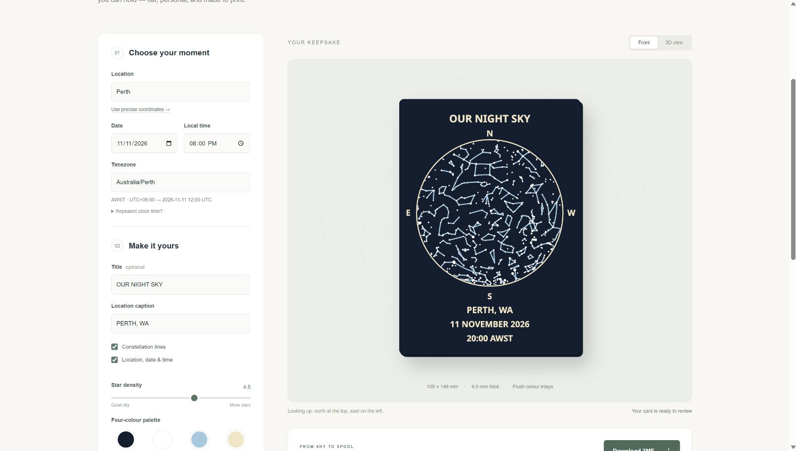

# Release validation — 11 November 2026

## Automated and independent checks

- 88 tests passed across five suites, including all 15 possible ways to share
  four palette roles among one to four colours.
- 48 independent Skyfield/JPL DE440s cases agree within 0.1 degrees on a matched
  UT1 timescale. Dates span 1900–2100 and include both poles.
- Production TypeScript/Vite build passed. npm audit reported no vulnerabilities.
- Independent Shapely/GEOS checks passed for colour coverage and overlap.
- Independently parsed 3MF meshes and reloaded binary STLs passed trimesh
  watertightness, winding and assembled-volume checks.
- Deliberately dense equatorial design is blocked at 123,740 triangles.
- Invalid dates, DST gaps/overlaps, unsupported glyphs, oversized captions,
  invalid coordinates, dimensions and failed models are covered by tests.

## Native Bambu Studio 02.09.01.70

| Sample | Triangles | 3MF bytes | Filaments | Decorative layers | Result |
|---|---:|---:|---:|---|---|
| Perth, 4 mm | 74,420 | 805,325 | 4 | 1–3; backing 4–20 | Pass |
| Perth, 8 mm | 74,420 | 805,325 | 4 | 1–3; backing 4–40 | Pass |
| London, 4 mm | 59,604 | 644,201 | 2 | 1–3; backing 4–20 | Pass |
| North Pole, 4 mm | 59,804 | 647,301 | 4 | 1–3; backing 4–20 | Pass |

All native runs returned zero, used no supports, remained within the plate, and
reported zero repaired edges, degenerate facets, removed/reversed facets and
backwards edges. The default 4 mm sample estimates approximately 2 h 5 min and
50.76 g, including purge/tower use; this is a slicer estimate.

[Exact file hashes and independent results](docs/release-checks.json) tie the
native evidence to those samples. Re-generating a file changes its report timestamp
and file hash; re-run native validation when exact artifact evidence is needed.

## Browser observations

Chrome displayed the generated default card, the same geometry in the rotatable
3D view, and passing model metrics. City search distinguished London in England
from other Londons. Editing an unselected search query disabled download controls
and marked the existing preview as stale. Search correctly supports either raw
gzip bytes or a body already decompressed by the host/browser.

The download control was activated, but the browser automation's download-event
capture timed out, so the saved browser download location was not independently
confirmed. Export bytes were verified separately through the same core code.
The responsive CSS is implemented; the browser viewport override did not take
effect, so a true mobile viewport remains a manual verification item.

## Physical proof

No physical print has been run. First-layer adhesion, minimum feature appearance,
colour opacity, dimensions, stiffness and packaged postal eligibility remain
unverified. A digital model check is not a physical-print guarantee. Each custom
file still requires its own native slice inspection before printing.
